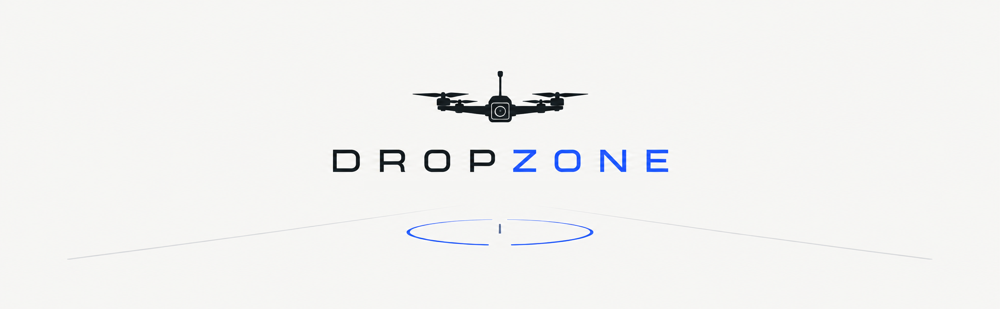

<p align="center">
  
</p>

A terminal tool for unloading drone footage from a memory card. You browse the card,
pick the recordings (with a preview and their metadata), name the flight location,
and Dropzone moves them into tidy folders:

```
<destination>/
├── [Lodz Park][2026-10-12]/
│   ├── DJI_20261012143005_0001_D.MP4
│   ├── DJI_20261012143005_0001_D.SRT
│   └── DJI_20261012143005_0001_D.LRF
└── [Airfield][2026-10-14]/
    └── ...
```

- One folder per flight location and day: `[<flight location>][<YYYY-MM-DD>]`.
- The date is taken from the file name (e.g. `DJI_20261012143005_0001_D.MP4`). Files without
  a date in the name use the file modification date (marked with `*`).
- Companion files with the same name (`.SRT` telemetry, `.LRF` low-res proxy) are moved
  together with each recording.

## Requirements

- Python 3.8 or newer. No extra packages are needed.
- Works on Windows, WSL, Linux and macOS.
- Optional: [VLC](https://www.videolan.org/) for previews. Without it, the system's default
  video player is used.

## Running

```
python dropzone.py              # Windows
python3 dropzone.py             # Linux / WSL / macOS

python dropzone.py E:\DCIM      # start browsing in a given folder
```

Run it in a terminal. On Windows, **Windows Terminal** is recommended over the classic
console window, because it displays all characters correctly.

## Steps

Every screen has the same layout: the step description at the top, a list in the middle
(with a details panel on the right where it makes sense), and the available keys at the bottom.

### 1. Choose the folder with recordings

A tree of drives and folders. Memory cards and USB drives are shown in green, and folders
that contain recordings show how many there are.

| Key | Action |
|---|---|
| `↑` `↓` `PgUp` `PgDn` `Home` `End` | move |
| `→` | expand a drive / folder (or go into an expanded one) |
| `←` | collapse a folder / jump to its parent |
| `Enter` | on a recording, or on a folder with recordings: choose that folder |
| `p` | play the highlighted recording |
| `r` | refresh the drive list (e.g. after inserting a card) |
| `q` | quit |

The last entry, **Enter a path…**, lets you type any folder to browse.

### 2. Select the recordings

The right panel shows details of the highlighted recording: resolution, frame rate, duration,
codec, bit depth, color (SDR / HLG / HDR10), bitrate, recording time, audio and, if there is
an `.SRT` file, flight telemetry (ISO, shutter, aperture, color mode, max height, start GPS).

| Key | Action |
|---|---|
| `Space` | select / unselect a recording |
| `Ctrl+Space` or `a` | select / unselect all |
| `p` | play |
| `Enter` | continue |
| `←` | back to the browser |

### 3. Choose the destination

The recently used destination folders are listed first; the last used one is highlighted,
so usually a single `Enter` is enough. Other options:

- **Browse for a folder…**: the same tree as in step 1, showing folders only.
  `Enter` chooses the highlighted folder, `Esc` cancels.
- **Type a path…**: the folder does not have to exist; it is created when moving.

### 4. Name the flight location

For each day of the selected recordings you type the location name. The list shows that
day's recordings, so you can preview them to remember where you flew; the details panel
also shows the start GPS position.

- **List mode**: `↑` `↓` move, `p` plays, `Tab` (or just start typing) switches to typing.
- **Typing mode**: `Enter` confirms, `Backspace` deletes, `Esc` / `Tab` / `↑` `↓` go back to the list.
- `Enter` on an empty name uses the name from the previous day.
- **Previously used** lists the location names found in the destination folder
  (taken from the existing `[location][date]` folder names); type a number to use one.
- `←` goes back to the previous day.

### 5. Check the plan

Shows exactly which file goes into which folder, with sizes, whether each folder is new
or already exists, files that are already in the target (they will be skipped), and a
warning if there is not enough free space. `Enter` starts moving, `←` goes back.

### Moving and report

While moving, the screen shows progress of the current file and of the whole transfer,
with speed and estimated time left. `Ctrl+C` stops: the file that was being copied stays
on the source.

Afterwards a report lists everything that was moved, skipped or failed. `Enter` returns
to the browser (refreshed, so you can continue with another folder), `q` quits.

## How files are moved safely

- Within the same drive, files are simply renamed (instant).
- Between drives, each file is copied to a temporary `.part` file, flushed to the disk,
  its size is verified, and only then the original is deleted.
- A file that already exists in the target folder is never overwritten; it is skipped and
  left on the source.

## Settings

`dropzone_config.json` next to the script is created on the first run. It remembers the
recently used destination folders (up to 5), separately for Windows, WSL, Linux and macOS,
because the same folder has a different path in each of them. It is safe to delete; it
will be created again.

## Testing without a real card

`make_test_card.py` creates a fake DJI card with recordings from several days, `.SRT`
telemetry, `.LRF` files, photos and other folders. The videos have real metadata but empty
picture data, so they show details but do not play.

```
python make_test_card.py                  # creates ./test_card (about 1.4 GB)
python make_test_card.py --small          # small files (about 70 MB)
python make_test_card.py C:\test_card     # somewhere else
python dropzone.py test_card
```

Moving within one drive is an instant rename, so to see the progress bar, create the test
card on a different drive than the destination.

## Notes

- **WSL**: Windows drives that are not mounted yet (e.g. a freshly inserted card) are shown
  as "not mounted"; opening one mounts it with `sudo`, which asks for your password.
  Accessing Windows drives from WSL is slower, so for the fastest transfers run Dropzone
  with Windows Python directly.
- **Speed**: the transfer is usually limited by the card reader or the target disk.
  Reading the card and writing the disk happen in parallel.
